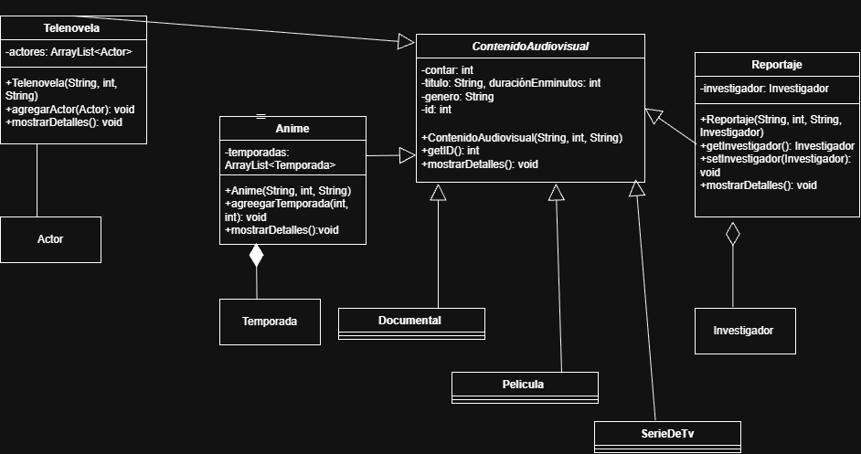
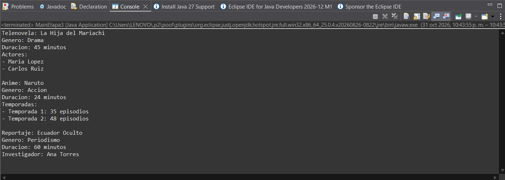

# Ampliación de Contenidos Audiovisuales

Proyecto de **Programación Orientada a Objetos** (Unidad 2) desarrollado en Java con Eclipse.
Parte del código de ejemplo de la Unidad 2 (`poo_unidad1`), al que se le agregaron nuevas clases, relaciones entre clases y un programa principal para probarlo todo.

## Objetivo y propósito

Ampliar y mejorar un proyecto Java usando conceptos de POO como **herencia**, **asociación**, **agregación** y **composición**. El proyecto modela distintos tipos de contenido audiovisual (películas, series, documentales, telenovelas, anime y reportajes) y las personas o partes que se relacionan con ellos (actores, temporadas e investigadores).

## Conceptos de POO aplicados

- **Clase abstracta y herencia:** todas las clases de contenido heredan de `ContenidoAudiovisual`, que guarda los datos comunes (id automático, título, duración y género).
- **Polimorfismo:** cada subclase implementa a su manera el método abstracto `mostrarDetalles()`.
- **Asociación:** una clase usa a otra, pero ambas existen por separado.
- **Agregación:** una clase contiene a otra, pero la contenida puede existir sin la contenedora.
- **Composición:** una clase crea y contiene a otra, y la contenida no existe sin ella.

## Clases del proyecto

**Clases originales (código base):** `ContenidoAudiovisual`, `Pelicula`, `SerieDeTV` y `Documental`.

**Clases de apoyo que se añadieron:**

| Clase | Atributos | Descripción |
|---|---|---|
| `Actor` | `nombre` | Persona que actúa en un contenido |
| `Temporada` | `numero`, `episodios` | Temporada con su cantidad de episodios |
| `Investigador` | `nombre` | Persona que investiga un tema |

**Subclases nuevas de `ContenidoAudiovisual`:**

| Subclase | Relación | Tipo | Descripción |
|---|---|---|---|
| `Telenovela` | con `Actor` | Asociación | Guarda una lista de actores con `agregarActor()` |
| `Anime` | con `Temporada` | Composición | Crea sus propias temporadas con `agregarTemporada()` |
| `Reportaje` | con `Investigador` | Agregación | Recibe un investigador ya creado en el constructor |

## Funcionalidades

- Crear objetos de cada tipo de contenido con su título, duración y género.
- Agregar actores a una telenovela y temporadas a un anime.
- Asignar un investigador a un reportaje.
- Mostrar la información de cada contenido con `mostrarDetalles()`.
- `MainEtapa3` crea objetos de las nuevas clases y prueba todas las relaciones.

## Diagrama de clases



## Instrucciones para clonar y ejecutar

### Requisitos
- Java JDK (el proyecto usa JavaSE-25)
- Eclipse IDE for Java Developers
- Git

### Pasos
1. Clonar el repositorio:
   ```
   git clone https://github.com/jordygilsejj/Ups.Poo.U2.JordyGilse.git
   ```
2. En Eclipse: **File → Import → General → Existing Projects into Workspace**, elegir la carpeta clonada y presionar **Finish**.
3. Abrir `src/uni1a/MainEtapa3.java`.
4. Clic derecho → **Run As → Java Application**.

No hay dependencias externas que instalar: solo se usa Java estándar.

### Ejemplo de salida

```
Telenovela: La Hija del Mariachi
Genero: Drama
Duracion: 45 minutos
Actores:
- Maria Lopez
- Carlos Ruiz

Anime: Naruto
Genero: Accion
Duracion: 24 minutos
Temporadas:
- Temporada 1: 35 episodios
- Temporada 2: 48 episodios

Reportaje: Ecuador Oculto
Genero: Periodismo
Duracion: 60 minutos
Investigador: Ana Torres
```



## Estructura de carpetas

```
ups.poo.uni2.jordygilse/
├── src/                                 código fuente de la aplicación
│   ├── uni1a/
│   │   ├── ContenidoAudiovisual.java    clase abstracta
│   │   ├── Pelicula.java
│   │   ├── SerieDeTV.java
│   │   ├── Documental.java
│   │   ├── Telenovela.java
│   │   ├── Anime.java
│   │   ├── Reportaje.java
│   │   └── MainEtapa3.java              programa principal
│   ├── ups.poo.uni2.jordygilse/
│   │   ├── Actor.java
│   │   ├── Temporada.java
│   │   └── Investigador.java
│   └── module-info.java
├── docs/
│   ├── diagrama-etapa3.png
│   └── consola.png
└── README.md
```

## Mejoras adicionales

- Se usó `@Override` en `mostrarDetalles()` para que el compilador verifique que se implementa el método abstracto.
- Se organizó el código en dos paquetes: uno para el contenido audiovisual y otro para las clases de apoyo.
- Se agregó la carpeta `docs/` con el diagrama de clases UML y la captura de la ejecución.


## Autor

Jordy Gilse
Universidad Politécnica Salesiana